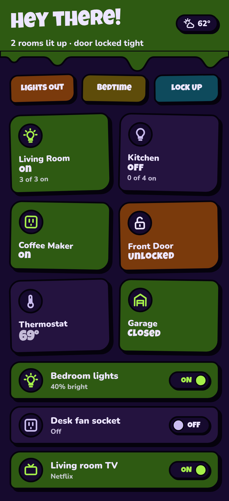
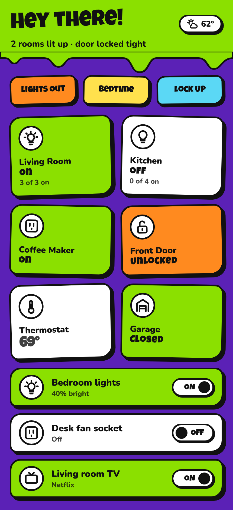
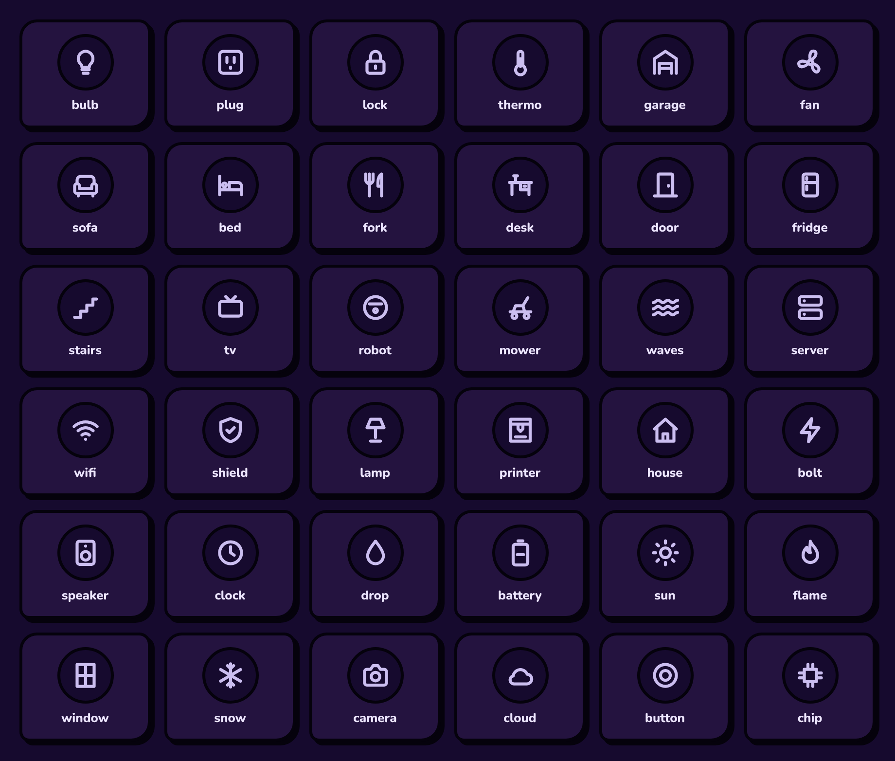

# Slime Time 🟢

A loud, 90s-cartoon look for Home Assistant: thick black outlines, wobbly corners, sticker shadows,
hand-drawn icons that bounce, and slime that drips off the header. It has a **dark mode that stays
easy on the eyes** (deep purples and moss greens, nothing neon) and a bright light mode.

| Dark mode | Light mode |
|---|---|
|  |  |

*Previews are rendered from the theme's real colors and icons with example entities.*

## What's in the box

| Folder | What it is |
|---|---|
| `themes/slime_time.yaml` | The theme (light + dark modes), with card-mod styling for standard tile cards |
| `button_card_templates/slime_templates.yaml` | The cartoon cards: tiles, toggle rows, sensors, lock/garage, scene buttons, thermostat parts |
| `icons/slime-icons.js` | Icon pack: use `slime:bulb`, `slime:sofa`, `slime:fridge`... anywhere HA takes an icon |
| `icons/slime-cards.js` | The cartoon brightness slider (`custom:slime-slider-card`) used on light tiles |
| `icons/svg/` | The same drawings as stroke SVGs (used by the cartoon cards' animated icon bubbles) |
| `samples/` | Ready-to-paste dashboards and cards |
| `tools/` | The icon source drawings and the script that builds the icon pack |

### The icons

36 hand-drawn icons, all the same chunky 2.5px round-stroke style.



## Install

**Requirements** (all from HACS → Frontend): [button-card](https://github.com/custom-cards/button-card),
[card-mod](https://github.com/thomasloven/lovelace-card-mod); optional:
[mini-graph-card](https://github.com/kalkih/mini-graph-card) for the graphs and
[auto-entities](https://github.com/thomasloven/lovelace-auto-entities) for the auto-built lists.

1. **Theme**: In HACS, open ⋮ → *Custom repositories*, add `https://github.com/dougkl/slime-time` with type **Theme**,
   then download *Slime Time*. (Or copy `themes/slime_time.yaml` into `/config/themes/`.) Make sure
   `configuration.yaml` has:
   ```yaml
   frontend:
     themes: !include_dir_merge_named themes
   ```
   Restart, or run the `frontend.reload_themes` action.

2. **Icons and slider**: copy the `icons/` folder to `/config/www/slime-icons/` so you have
   `/config/www/slime-icons/slime-icons.js`, `/config/www/slime-icons/slime-cards.js` and `/config/www/slime-icons/*.svg`.

3. **Resources** (Settings → Dashboards → ⋮ → Resources):
   | URL | Type |
   |---|---|
   | `/local/slime-icons/slime-icons.js` | JavaScript module |
   | `/local/slime-icons/slime-cards.js` | JavaScript module |
   | `https://fonts.googleapis.com/css2?family=Luckiest+Guy&family=Nunito:wght@700;800;900&display=swap` | Stylesheet |

4. **Templates**: open your dashboard → ✏️ → ⋮ → *Raw configuration editor* and paste the
   `button_card_templates:` block from `button_card_templates/slime_templates.yaml` at the top.

5. **Pick the theme**: Profile → Theme → *Slime Time*, or for everyone with the `frontend.set_theme` action:
   ```yaml
   action: frontend.set_theme
   data:
     name: Slime Time
     name_dark: Slime Time
   ```
   If a dashboard view has its own `theme:` set, change it to `Slime Time` too, since that overrides the default.

## Samples

| File | What you get |
|---|---|
| [`01-quickstart-tiles.yaml`](samples/01-quickstart-tiles.yaml) | Light, outlet, fan, lock, garage and sensor tiles in a 2-column grid |
| [`02-home-dashboard.yaml`](samples/02-home-dashboard.yaml) | A full home dashboard: dripping header with a live summary, quick-action buttons, room tiles |
| [`03-toggle-rows.yaml`](samples/03-toggle-rows.yaml) | Full-width rows with a chunky ON/OFF pill, plus an auto-built list of every light |
| [`04-thermostat.yaml`](samples/04-thermostat.yaml) | Cartoon thermostat: dial, giant set-point, ± buttons, mode/fan/eco pills, temperature graph |
| [`05-sensors-and-graphs.yaml`](samples/05-sensors-and-graphs.yaml) | Temperature/humidity tiles and a thick, smoothed history graph |
| [`06-icons-on-standard-cards.yaml`](samples/06-icons-on-standard-cards.yaml) | Only the icon pack, on Home Assistant's own tile cards |

Each sample uses example entity ids (`light.living_room`, `lock.front_door`, `climate.living_room`...),
so swap in your own. Add a single card with *Add card → Manual*, or paste a whole dashboard
(`02`) into the raw configuration editor.

### How the cards behave

- **Lights / outlets / fans**: tap to toggle, hold for details. On = slime-green tile, glowing icon, a little bounce.
  Light groups show "2 of 4 on"; single lights show their brightness.
- **Brightness slider**: dimmable lights get a chunky slider on the tile. Drag it (or use the arrow keys) to set the
  brightness; dragging an off light turns it on at that level, and the slider never toggles the tile.
  It also works as a standalone card:
  ```yaml
  type: custom:slime-slider-card
  entity: light.living_room
  ```
- **Locks / garage**: green when locked/closed; orange and wiggling when unlocked/open. Tapping opens details
  instead of toggling, so nothing unlocks by accident.
- **Toggle rows** work for lights, switches and media players (TVs and speakers show what's playing).
- Animations switch off automatically when the device has *reduce motion* enabled.

## Make it yours

All colors live in the theme as `--slime-*` variables (`slime-on-bg`, `slime-alert-bg`, `slime-ink`,
`slime-scene-1`...), separately for light and dark mode, and every card reads from them. Change them in
`themes/slime_time.yaml` and everything follows.

To add or change icons, edit `tools/icons.py` (24×24 stroke paths) and run:

```bash
pip install skia-python svgelements
python tools/build_icons.py
```

## License

MIT. The icons and card designs are original artwork made for this project.
